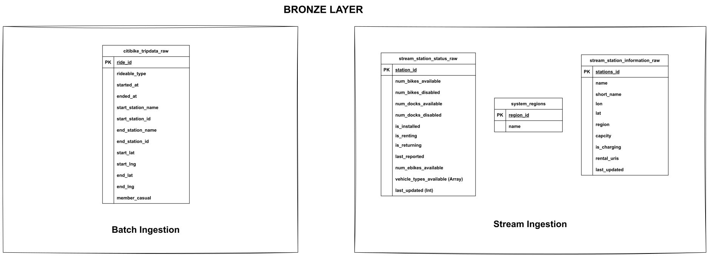

    MINIO --> LOAD["Airflow: load_and_publish"]
    LOAD --> WORK["ClickHouse work table"]
    WORK --> VERIFY["Verify stored counts and batch metadata"]
    VERIFY --> BRONZE["ClickHouse: published bronze month"]

    GBFS["GBFS status, station information, regions"] --> NIFI["NiFi: HTTP polling"]
    NIFI --> RAWJSON["ClickHouse: bronze JSON responses"]

    BRONZE --> DBT["Airflow: build_analytics / dbt build"]
    RAWJSON --> DBT
    DBT --> SILVER["Silver: staging views"]
    SILVER --> GOLD["Gold: dimensions, facts, aggregates and marts"]
    GOLD --> FUTURE["Future dashboard"]

This is **ELT**: source records land in ClickHouse before analytical cleaning and transformation. Integrity checks on files before loading do not change that architecture.

Medallion layers are logical groups inside the **citibike** database. Separate databases named bronze, silver, and gold are not created by the current implementation.

| Layer | Implementation | Purpose |
| --- | --- | --- |
| Bronze | raw_citibike_tripdata_v2 and three stream raw tables | Preserve original trip field values and complete JSON response objects, with ingestion metadata. |
| Silver | stg_citibike__* views | Convert types, normalize missing values, unpack arrays, and apply implemented snapshot handling. |
| Gold | Dimensions, facts, aggregates, priority and availability marts | Expose conformed entities and business metrics. |
| Gold support | int_station_hourly_demand_baseline | Supply historical weekday/hour comparisons. |

The modeling approach is **dimensional modeling**: region and station dimensions support trip and station-observation facts. Aggregates and marts answer specific analytical questions. Dimensions hold latest-known values rather than full slowly changing dimension history.

## ERD Diagram for Bronze Layer

## Sources and storage

### Batch: monthly trip history

The project uses the NYC September 2026 release, without the Jersey City files prefixed JC. The publisher splits large monthly releases into multiple CSVs within an archive. These parts belong to one release and should be combined by appending rows. [Citi Bike system data](https://citibikenyc.com/system-data)

| File | Rows |
| --- | ---: |
| 202609-citibike-tripdata_1.csv | 1,000,000 |
| 202609-citibike-tripdata_2.csv | 1,000,000 |
| 202609-citibike-tripdata_3.csv | 1,000,000 |
| 202609-citibike-tripdata_4.csv | 1,000,000 |
| 202609-citibike-tripdata_5.csv | 982,855 |
| **Total** | **4,982,855** |

These counts describe this specific download, not a requirement for every future month.

The 13 source columns are:

ride_id, rideable_type, started_at, ended_at,
start_station_name, start_station_id,
end_station_name, end_station_id,
start_lat, start_lng, end_lat, end_lng, member_casual

Identifiers and all original CSV fields initially remain strings. The loader adds source_locator, batch_id, release_month, and a warehouse-generated ingested_at.

### Streaming: GBFS HTTP polling

| Feed | Source | Purpose |
| --- | --- | --- |
| Station status | [station_status.json](https://gbfs.lyft.com/gbfs/2.3/bkn/en/station_status.json) | Bike/dock availability and operating flags. |
| Station information | [station_information.json](https://gbfs.lyft.com/gbfs/2.3/bkn/en/station_information.json) | Names, codes, coordinates, capacity, and region references. |
| System regions | [system_regions.json](https://gbfs.lyft.com/gbfs/2.3/bkn/en/system_regions.json) | Publisher-defined region names. |

This is **near-real-time polling of snapshots**. The feeds do not emit individual ride events. Historical trips answer usage questions; status snapshots answer availability questions.

A complete HTTP response is stored in a String column called raw_payload. Nested fields, including vehicle_types_available, remain available in Bronze even when Silver does not currently project them. One response can contain many stations.

### MinIO object layout

~~~text
citibike-tripdata-batch/
├── batch-manifest-2026-09.json
└── 202609-citibike-tripdata/
    ├── 202609-citibike-tripdata_1.csv
    ├── 202609-citibike-tripdata_2.csv
    ├── 202609-citibike-tripdata_3.csv
    ├── 202609-citibike-tripdata_4.csv
    └── 202609-citibike-tripdata_5.csv

citibike-xcom/
~~~

The initializer creates both buckets. Creating a bucket does not upload files.

**XCom status:** the current DAG sets do_xcom_push=False on both tasks. It does not transfer CSVs, manifests, or connection objects through XCom. The existence of citibike-xcom is preparation, not evidence that object-storage XCom is active.

### Three different metadata documents

| File | Meaning | Current execution role |
| --- | --- | --- |
| manifest.yaml | Project-level source catalog, intended schedules, relationships, and policies. | Documentation/design configuration; not consumed by the current loader or DAG. Some planned relation names differ from actual tables. |
| schema_contract.yaml | JSON Schema expressed in YAML, plus proposed quality rules. | Contract documentation; not automatically enforced by the current ingestion flow. |
| batch-manifest-2026-09.json | Exact description of one acquired release. | Read and validated by the loader before publication. |

The JSON batch manifest records filenames, column names, row counts, byte sizes, SHA-256 checksums, release month, source identifier, and a deterministic batch_id. That identifier detects changes to the described batch; it is not a digital signature.

## Repository layout

~~~text
citibike/
├── README.md
├── Makefile
├── requirements.txt
├── .env.example
├── manifest.yaml
├── schema_contract.yaml
├── batch-manifest-2026-09.json
├── containers/
│   ├── airflow/
│   │   ├── Dockerfile
│   │   ├── docker-compose.yaml
│   │   └── dags/citibike.py
│   ├── clickhouse/docker-compose.yaml
│   ├── minio/docker-compose.yaml
│   └── nifi/docker-compose.yaml
├── src/
│   ├── batch_manifest.py
│   ├── manifest_reader.py
│   ├── createTable.py
│   ├── data_loader.py
│   └── readObject.py
├── utils/
│   ├── credentials.py
│   ├── dwh_connect.py
│   ├── s3_connect.py
│   └── logging_config.py
├── citibike_analytics/
│   ├── README.md
│   ├── dbt_project.yml
│   ├── packages.yml
│   ├── package-lock.yml
│   ├── macros/
│   ├── models/
│   │   ├── staging/
│   │   ├── intermediate/
│   │   └── marts/
│   └── tests/
└── tests/
~~~

Local files also include .env, the MinIO license, downloaded CSVs, the dbt profile, and generated logs/artifacts. These are not all distributed with the repository.

| Module | Responsibility |
| --- | --- |
| batch_manifest.py | Inspect local CSVs and generate a release manifest. |
| manifest_reader.py | Validate the manifest and hash the referenced MinIO objects. |
| createTable.py | Create legacy/stream tables and create per-attempt work tables. |
| data_loader.py | Load chunks, verify warehouse rows, and publish a complete month. |
| readObject.py | General CSV object-listing helper; the active loader instead follows the manifest. |
| dwh_connect.py | Create a caller-owned ClickHouse client. |
| s3_connect.py | Create a configured Boto3 client for MinIO. |
| logging_config.py | Expose an import-ready logger with console and file handlers. |

## Requirements and configuration

### Runtime versions

| Component | Current repository configuration |
| --- | --- |
| Airflow | apache/airflow:3.3.2-python3.12, custom image, CeleryExecutor |
| NiFi | apache/nifi:2.12.0 |
| ClickHouse | clickhouse/clickhouse-server:26.8 |
| MinIO | quay.io/minio/aistor/minio:latest |
| MinIO initializer | quay.io/minio/aistor/mc:RELEASE.2026-02-07T19-37-38Z |
| PostgreSQL | postgres:16, Airflow metadata |
| Redis | redis:7.2-bookworm, Celery broker |
| Python packages | boto3 1.43.123; clickhouse-connect 1.11.0; pandas 3.1.0; python-dotenv 1.2.4 |
| dbt CLI | 2.0.9 |
| dbt packages | Lock file resolves dbt_utils 1.4.1 and codegen 0.14.1 |

The Dockerfile installs pipeline dependencies in **/opt/citibike-venv**, separate from Airflow's Python environment. The DAG calls those executables explicitly. Do not assume that importing pipeline packages in Airflow's own Python uses that environment.

This project uses the verified **dbt 2 CLI** pinned in requirements.txt. [dbt installation documentation](https://docs.getdbt.com/docs/local/install-dbt)

Install Docker Engine, Docker Compose v2, GNU Make, and Python for local manifest generation. Python 3.12 matches the container runtime. Allow sufficient memory and disk for all services, raw files, dbt tables, and a full extra batch work table. The Airflow Compose deployment is a local development foundation. [Airflow Docker guide](https://airflow.apache.org/docs/apache-airflow/stable/howto/docker-compose/index.html)

All shell commands below run from the repository root unless stated otherwise.

### Environment file

Copy .env.example to .env **only on a fresh checkout**; preserve an existing configured file.

The current example file is incomplete. Add the MinIO and Airflow settings as well. The following is a template, not a set of usable secrets:

~~~dotenv
CLICKHOUSE_DB=citibike
CLICKHOUSE_HOST=localhost
CLICKHOUSE_USER=pipeline
CLICKHOUSE_PASSWORD=REPLACE_WITH_A_PRIVATE_PASSWORD
CLICKHOUSE_HTTP_PORT=8123
CLICKHOUSE_NATIVE_PORT=9000