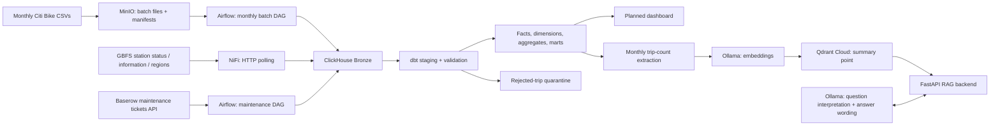
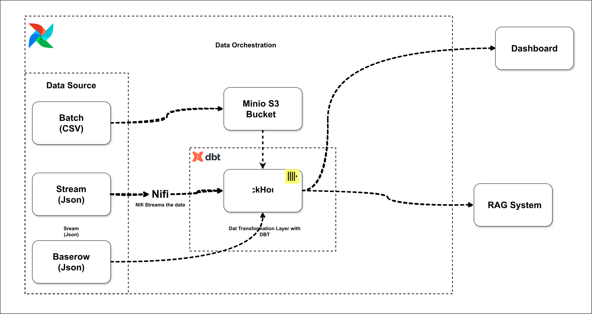
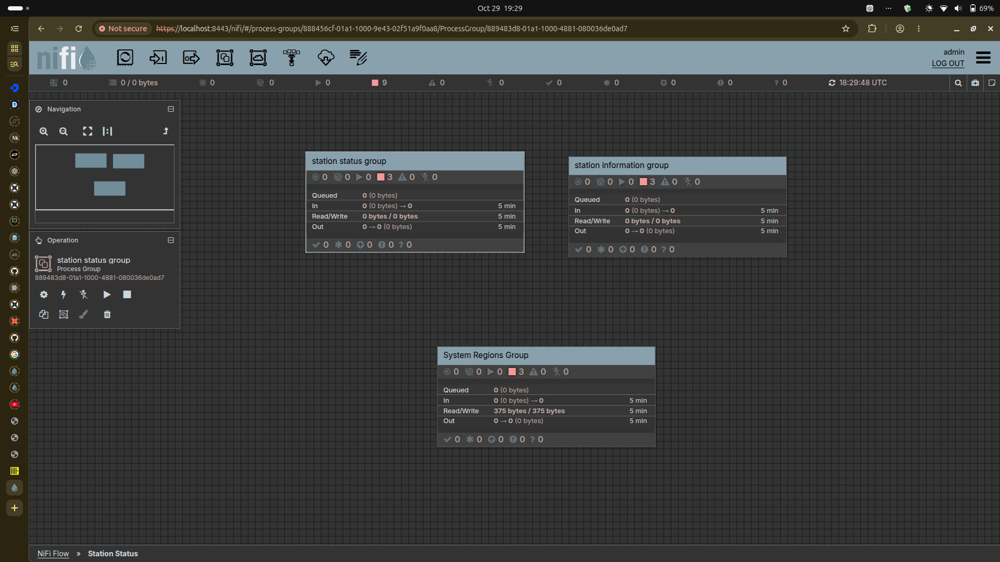
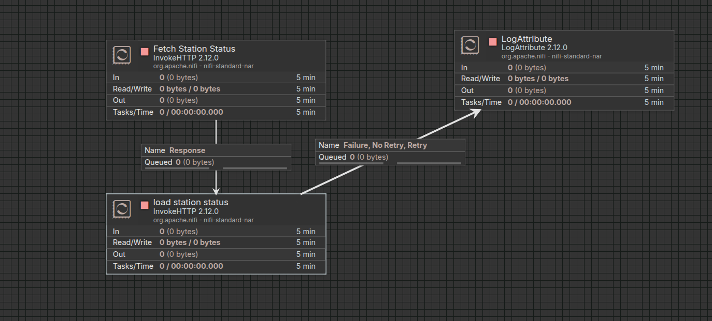
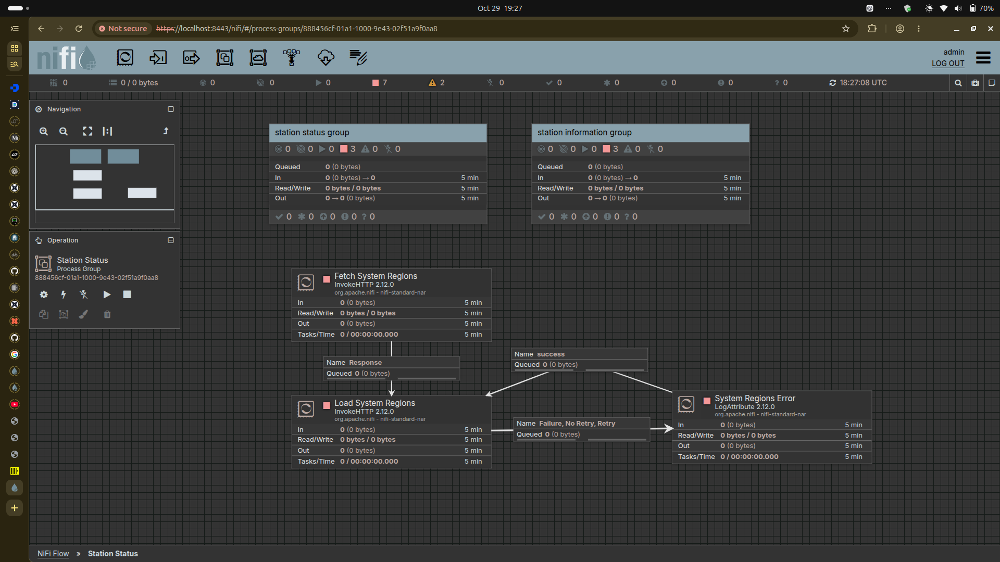
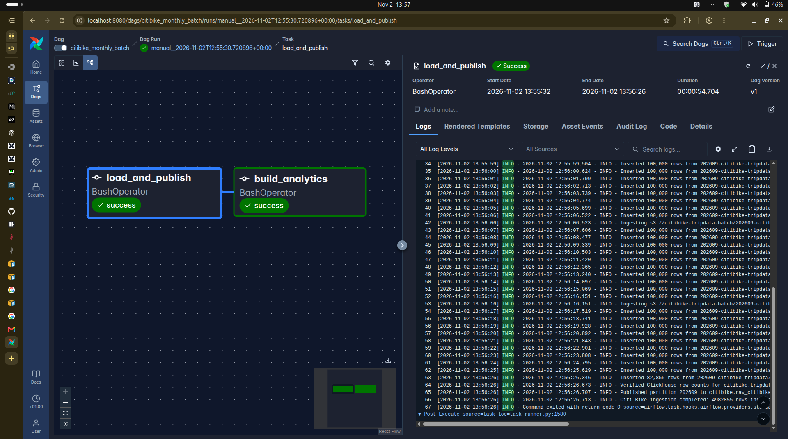
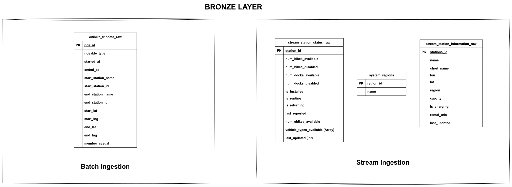
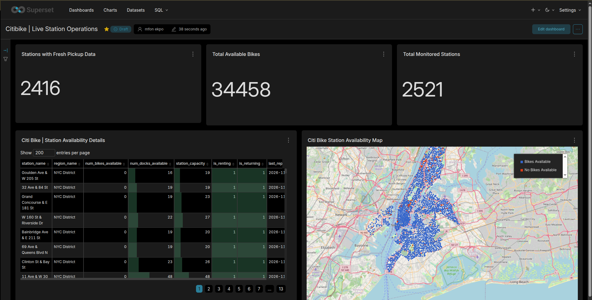

# Citi Bike Data Platform

A local, containerized **ELT data engineering project** combining historical Citi Bike trip files, near-real-time GBFS station feeds, and operational maintenance tickets from Baserow. The platform uses **MinIO, Apache Airflow, Apache NiFi, ClickHouse, Python, and dbt** to ingest, validate, model, and serve analytical data. A **FastAPI RAG backend** uses **Ollama and Qdrant** to answer monthly trip-count questions from the modeled warehouse data.

The pipeline supports month-selectable historical backfills, repeatable monthly publication, row-level trip validation and quarantine, current station availability, rebalancing signals, and maintenance workload metrics. A dashboard is a planned consumer of the curated models; it is not included in this repository.

> **Implementation status (November 2026):** April 2026 and September 2026 trip releases have been loaded and successfully reprocessed without duplicating Bronze rows. Multi-month demand baselines and the row-level trip validation/quarantine path have been built and checked. Efficient cross-row duplicate resolution, automated quarantine reconciliation tests, synthetic rejection tests, and full SCD Type 2 as-of trip joins remain follow-up work; see [Known limitations](#known-limitations-and-next-steps).

The RAG implementation includes structured warehouse extraction, embedding/upsert verification, guarded question answering, twice-daily refresh scheduling, and on-demand refresh job tracking. Its current knowledge scope is **monthly trip counts from `citibike.fct_trips`**; it does not expose every warehouse model or provide a custom frontend.

## Contents

- [Architecture](#architecture)
- [Data sources](#data-sources)
- [Repository structure](#repository-structure)
- [Getting started](#getting-started)
- [Monthly trip ingestion and backfills](#monthly-trip-ingestion-and-backfills)
- [Baserow maintenance-ticket integration](#baserow-maintenance-ticket-integration)
- [Transformation and quarantine](#transformation-and-quarantine)
- [RAG backend: ClickHouse, Ollama, Qdrant, and FastAPI](#rag-backend-clickhouse-ollama-qdrant-and-fastapi)
- [Operational checks](#operational-checks)
- [Known limitations and next steps](#known-limitations-and-next-steps)

## Architecture



**ELT:** source records are landed in ClickHouse before SQL cleansing and business transformations. File integrity checks take place before batch publication. Bronze, Silver, and Gold are **logical layers in the `citibike` database**, not three separate ClickHouse databases.

| Layer | Implemented relations / purpose |
| --- | --- |
| Bronze | `raw_citibike_tripdata_v2`, three GBFS raw-response tables, `baserow_maintenance_tickets_raw`, and `baserow_completed_extractions`. |
| Silver | `stg_citibike__*` views that normalize and parse source fields; `int_trip_validation` classifies individual trips. |
| Quarantine | `tripdata_quarantine` stores trip rows currently classified as `REJECTED`, including validation codes and original source values. |
| Gold | Trips, station availability, station/region dimensions, demand aggregates, rebalancing, and maintenance-ticket analytics. |

### Project diagrams














## Data sources

### 1. Monthly trip-history CSVs (batch)

Source: [Citi Bike system data](https://citibikenyc.com/system-data). This project uses the NYC release files, excluding Jersey City files with the `JC` prefix. Multiple CSV parts for a month form a single release and are appended at ingest.

| Loaded release | CSV parts | Verified rows |
| --- | ---: | ---: |
| April 2026 (`2026-04`) | 4 | 3,860,371 |
| September 2026 (`2026-09`) | 5 | 4,982,855 |
| **Combined** | **9** | **8,843,226** |

The 13 publisher fields are: `ride_id`, `rideable_type`, `started_at`, `ended_at`, `start_station_name`, `start_station_id`, `end_station_name`, `end_station_id`, `start_lat`, `start_lng`, `end_lat`, `end_lng`, and `member_casual`.

Bronze preserves these as strings and adds `source_locator`, `batch_id`, `release_month`, and `ingested_at`. The current target is **`citibike.raw_citibike_tripdata_v2`**, partitioned by `release_month`.

### 2. GBFS station snapshots (NiFi streaming)

| Feed | What it supplies |
| --- | --- |
| [`station_status.json`](https://gbfs.lyft.com/gbfs/2.3/bkn/en/station_status.json) | Bike/dock counts, rental/return status, and report timestamps. |
| [`station_information.json`](https://gbfs.lyft.com/gbfs/2.3/bkn/en/station_information.json) | Station names, short codes, coordinates, capacity, and region references. |
| [`system_regions.json`](https://gbfs.lyft.com/gbfs/2.3/bkn/en/system_regions.json) | Region identifiers and names. |

NiFi **polls station snapshots**; these are not ride-event streams. Full responses are retained as `raw_payload` in three Bronze tables: `stream_stations_status_raw`, `stream_station_information_raw`, and `stream_system_regions_raw`. The latest-availability model is designed to serve live dashboard queries without discarding the historical raw responses.

### 3. Baserow maintenance tickets (Airflow + REST API)

Baserow is the project's **operational ticket source**, separate from Citi Bike's public feeds. The Airflow DAG `citibike_baserow_maintenance` calls the Baserow row API, ingests the current ticket snapshot, and builds maintenance analytics. It does **not** run Baserow itself in Docker or capture a real-time event stream.

The source payload includes fields such as `ticket_id`, `station_code`, `issue_type`, `status`, `priority`, `reported_at`, `resolved_at`, and `repair_cost_usd`. Choice fields such as `issue_type`, `status`, and `priority` are nested JSON objects: the dbt staging model extracts their `.value` attributes.

See [Baserow maintenance-ticket integration](#baserow-maintenance-ticket-integration) for the complete flow and configuration.

## Repository structure

```text
citibike/
├── README.md
├── Makefile
├── .env.example
├── requirements.txt
├── manifest.yaml
├── schema_contract.yaml
├── containers/
│   ├── airflow/
│   │   ├── Dockerfile
│   │   ├── docker-compose.yaml
│   │   └── dags/
│   │       ├── citibike.py        # Monthly trip backfill
│   │       └── baserow.py         # Maintenance-ticket extraction
│   ├── clickhouse/docker-compose.yaml
│   ├── minio/docker-compose.yaml
│   └── nifi/docker-compose.yaml
├── src/
│   ├── createTable.py
│   ├── batch_manifest.py
│   ├── manifest_reader.py
│   ├── data_loader.py
│   ├── baserow_reader.py
│   ├── baserow_loader.py
│   └── readObject.py
├── utils/
│   ├── credentials.py
│   ├── dwh_connect.py
│   ├── s3_connect.py
│   └── logging_config.py
├── citibike_analytics/
│   ├── README.md
│   ├── dbt_project.yml
│   ├── models/
│   │   ├── staging/
│   │   ├── intermediate/
│   │   └── marts/
│   └── tests/
├── rag_system/
│   ├── docker-compose.yaml       # Ollama and one-off model initialization
│   ├── api/
│   │   └── main.py               # API, scheduler, and refresh job tracking
│   ├── ingestion/
│   │   ├── monthly_tripcount.py  # ClickHouse extraction and document builder
│   │   └── embed.py              # Embedding, Qdrant upsert, and verification
│   ├── retrieval/
│   │   └── search.py             # Intent, retrieval, and grounded answers
│   └── quardrails/
│       └── validation.py         # Strict evidence validation and calculations
└── tests/
```

Some models described below (notably the new trip-validation and quarantine models) were created after the last shared ZIP snapshot. This README reflects the working changes reported in the project workflow, not a claim that those new files were present in that older archive.

## Getting started

### Runtime components

| Component | Configuration in the available repository snapshot |
| --- | --- |
| Airflow | `apache/airflow:3.3.2-python3.12`, CeleryExecutor |
| NiFi | `apache/nifi:2.12.0` |
| ClickHouse | `clickhouse/clickhouse-server:26.8` |
| MinIO | `quay.io/minio/aistor/minio:latest` |
| PostgreSQL / Redis | Airflow metadata / Celery broker |
| dbt CLI | `2.0.9` in `requirements.txt` |
| Python | 3.12 container runtime |
| RAG backend | FastAPI/Uvicorn on the host; APScheduler 3.x and Pydantic 2.x |
| Ollama | `ollama/ollama:latest`; `qwen2.5:1.5b` and `nomic-embed-text` |
| Qdrant | Configured cloud endpoint; the local Compose service is commented out |

Install Docker Engine, Docker Compose v2, and GNU Make. Allow enough memory and disk for the Airflow stack, ClickHouse, a monthly work table, and dbt table builds.

### Environment variables

Copy `.env.example` to `.env` on a **fresh** checkout; don't overwrite an existing configured file. Configure the variables for each service and the container networking mode you are using. Typical required variables include:

```dotenv
CLICKHOUSE_DB=citibike
CLICKHOUSE_HOST=clickhouse
CLICKHOUSE_HTTP_PORT=8123
CLICKHOUSE_USER=REPLACE_WITH_USER
CLICKHOUSE_PASSWORD=REPLACE_WITH_PASSWORD

MINIO_BUCKET=citibike-tripdata-batch
MINIO_ENDPOINT_URL=http://minio:9000
# Also configure the MinIO access/secret credentials used by utils/s3_connect.py.

DBT_PROJECT_DIR=/opt/citibike/citibike_analytics
DBT_PROFILES_DIR=/opt/citibike/citibike_analytics

BASEROW_API_TOKEN=REPLACE_WITH_PRIVATE_TOKEN
BASEROW_TABLE_ID=REPLACE_WITH_NUMERIC_TABLE_ID

# RAG: use the full URL and API key supplied by Qdrant Cloud.
QDRANT_ENDPOINT=https://YOUR-CLUSTER.cloud.qdrant.io:6333
QDRANT_API_KEY=REPLACE_WITH_PRIVATE_KEY
```

`clickhouse` and `minio` are container-network hostnames. If running a Python command directly on the host, use the correct host-accessible addresses instead. Do not commit `.env`, real API tokens, passwords, or downloaded private Baserow ticket data.

The dbt profile (`profiles.yml`) must point to ClickHouse. Airflow uses `/opt/citibike-venv/bin/python` and `/opt/citibike-venv/bin/dbt` installed in the custom worker image.

### Start services and initialize Bronze tables

From the repository root:

```bash
make up
make init-db
```

`make init-db` is the initialization command documented in the supplied root README. **Check that your current `Makefile` defines it:** the older project ZIP does not yet contain that target. The target should invoke `src.createTable` in an environment with valid ClickHouse credentials. `src/createTable.py` declares `raw_citibike_tripdata_v2`, the three GBFS raw tables, and both Baserow raw/extraction-control tables in the updated workflow.

Verify tables in ClickHouse:

```sql
SHOW CREATE TABLE citibike.raw_citibike_tripdata_v2;
SHOW CREATE TABLE citibike.baserow_maintenance_tickets_raw;
SHOW CREATE TABLE citibike.baserow_completed_extractions;
```

`CREATE TABLE IF NOT EXISTS` is safe to repeat but **does not migrate** an existing table definition. Avoid deleting Bronze tables when updating a schema.

## Monthly trip ingestion and backfills

### MinIO layout

The current object-store pattern keeps both CSVs and per-release manifests in the `citibike-tripdata-batch` bucket:

```text
citibike-tripdata-batch/
├── manifests/
│   ├── batch-manifest-2026-04.json
│   └── batch-manifest-2026-09.json
├── 202604-citibike-tripdata/
│   ├── 202604-citibike-tripdata_1.csv
│   └── ... (4 files total)
└── 202609-citibike-tripdata/
    ├── 202609-citibike-tripdata_1.csv
    └── ... (5 files total)
```

The initializer may create a separate `citibike-xcom` bucket, but the batch DAG does **not** pass CSVs or manifests via XCom; the files remain in MinIO.

### Backfill one release

1. Upload all CSV parts for the selected month into its `YYYYMM-citibike-tripdata/` prefix in MinIO.
2. Create and publish a month-specific manifest from those **MinIO objects** (the current implementation computes file checksums and counts rather than relying on a host-local CSV folder).
3. Validate the manifest and file objects before loading.
4. Trigger the `citibike_monthly_batch` Airflow DAG with its `release_month` parameter (for example, `2026-04`).
5. Airflow verifies the selected release, loads its month, and builds analytics via dbt.

Commands below execute **from the repository root** and use the Airflow worker's Python environment:

```bash
# April example: create/publish a manifest for four MinIO CSV parts
docker compose --env-file .env -f containers/airflow/docker-compose.yaml exec airflow-worker \
  /opt/citibike-venv/bin/python -m src.batch_manifest \
  --release-month 2026-04 --expected-files 4 --publish

# April example: check the stored manifest and source objects, without loading
docker compose --env-file .env -f containers/airflow/docker-compose.yaml exec airflow-worker \
  /opt/citibike-venv/bin/python -m src.data_loader \
  --manifest-key manifests/batch-manifest-2026-04.json \
  --data-prefix 202604-citibike-tripdata/ --validate-only
```

For September, change to `2026-09`, `--expected-files 5`, `manifests/batch-manifest-2026-09.json`, and `202609-citibike-tripdata/`.

The updated Airflow DAG accepts a run-specific `release_month` (format `YYYY-MM`), derives the matching manifest key/data prefix, and runs manifest validation, publication, and dbt builds. Trigger it manually from the Airflow UI; it has no automatic schedule in the available implementation.

### Publication and rerun behavior

The loader creates a temporary ClickHouse work table using the target schema, loads the month's CSVs, checks counts and batch metadata, and publishes a complete month with `REPLACE PARTITION`. A rerun **replaces that month** rather than appending another copy. Other release-month partitions remain intact.

Verified example:

```sql
SELECT release_month,
       count() AS total_rows,
       uniqExact(batch_id) AS distinct_batches
FROM citibike.raw_citibike_tripdata_v2
GROUP BY release_month
ORDER BY release_month;
```

Expected for the two loaded releases: **3,860,371 April rows**, **4,982,855 September rows**, and **one batch per release month**. Re-running April was observed to leave those counts unchanged.

**Historical analytics:** `int_station_hourly_demand_baseline` now rebuilds weekday/hour demand baselines for **all available release months** instead of only the month most recently loaded. The operational rebalancing mart selects the **latest available baseline month** to avoid duplicate station rows.

## Baserow maintenance-ticket integration

### What the integration does

`containers/airflow/dags/baserow.py` defines the **`citibike_baserow_maintenance`** DAG. The workflow is manual (`schedule=None`), uses two tasks, and is independent of the monthly trip DAG:

```text
Baserow API
  └── src.baserow_reader.fetch_baserow_tickets
        └── src.baserow_loader
              ├── citibike.baserow_maintenance_tickets_raw
              └── citibike.baserow_completed_extractions
                    └── dbt: stg_citibike__baserow_maintenance_tickets
                          └── fct_maintenance_tickets
                                └── agg_station_maintenance
```

The actual Airflow task chain is `load_baserow` → `build_baserow_analytics`. The latter runs `dbt build --select +agg_station_maintenance` and provides `baserow_maintenance_table_id` from `BASEROW_TABLE_ID`.

**Reader (`src/baserow_reader.py`):** authenticates with a private API token; requests named fields (`user_field_names=true`); paginates up to 200 rows per page; verifies the API-reported total and unique Baserow row IDs; and returns a single extraction with a UUID and UTC extraction time.

**Loader (`src/baserow_loader.py`):** serializes complete original row objects into `raw_payload`, inserts the extraction, checks count and distinct row IDs, then writes a **completion marker**. Staging reads **only the latest completed extraction** for the configured table ID. This prevents an incomplete extraction from silently becoming the current modeled snapshot.

**dbt models:**

| Model | Grain / output |
| --- | --- |
| `stg_citibike__baserow_maintenance_tickets` | One ticket per Baserow row in the latest completed extraction; parses categories, timestamps, and decimal repair cost. |
| `fct_maintenance_tickets` | One current ticket enriched with the latest station metadata; includes mapping status, backlog/resolution flags, and `resolution_hours`. |
| `agg_station_maintenance` | Maintenance workload by station code: open/in-progress/resolved counts, high-priority backlog, average resolution time, and recorded costs. |

Baserow ticket attributes are operational input, not GBFS station status. The latest-extraction staging policy produces a **current snapshot**, not a ticket-history SCD or event-by-event change log. Raw extractions remain available for investigation.

### Run and verify

Set `BASEROW_API_TOKEN` and `BASEROW_TABLE_ID` securely in the Airflow runtime, ensure the Bronze tables exist, then trigger **`citibike_baserow_maintenance`** in the Airflow UI. For a manual rerun from the worker:

```bash
docker compose --env-file .env -f containers/airflow/docker-compose.yaml exec airflow-worker \
  /opt/citibike-venv/bin/python -m src.baserow_loader
```

Check completion markers and the modeled results:

```sql
SELECT baserow_table_id, extracted_at, expected_rows, completed_at
FROM citibike.baserow_completed_extractions
ORDER BY completed_at DESC LIMIT 5;

SELECT count() FROM citibike.stg_citibike__baserow_maintenance_tickets;
SELECT count() FROM citibike.fct_maintenance_tickets;
SELECT count() FROM citibike.agg_station_maintenance;
```

The standalone loader only ingests data; run the Airflow DAG or the relevant dbt build to refresh maintenance analytics afterward. A reported repair cost of `NULL` means **unknown**, not zero.

## Transformation and quarantine

### Row-level trip validation

`stg_citibike__raw_citibike_tripdata` casts and normalizes the Bronze strings, while preserving original timestamp and coordinate strings (`raw_started_at`, `raw_ended_at`, `raw_start_lat`, `raw_start_lng`, `raw_end_lat`, `raw_end_lng`) for error investigation.

`int_trip_validation` evaluates **each trip row**, attaching `error_codes`, `warning_codes`, and a `validation_status`:

- **`VALID`**: passes the implemented rejection rules and is eligible for `fct_trips`.
- **`REJECTED`**: fails one or more rules; retained in `int_trip_validation` and selected into `tripdata_quarantine`.
- Warnings such as missing station identifiers or unusual durations can coexist with `VALID`; they do not automatically remove a trip.

Implemented rejection checks cover blank ride IDs; unparseable/malformed or out-of-order trip timestamps; unexpected bike/membership categories; and invalid nonblank coordinates. `fct_trips` reads validated trips with `WHERE validation_status = 'VALID'` rather than silently filtering invalid trip times.

The current `tripdata_quarantine` model is a **dbt table** rebuilt from rows marked `REJECTED`. Its key diagnostic columns include `ride_id`, `release_month`, `source_locator`, `batch_id`, original raw values, and `error_codes`. Because the two loaded months passed the implemented row-level checks, it may be empty; this is not proof that synthetic rejected records or duplicate handling have been tested.

**Not yet implemented:** scalable exact-replay/conflicting-ride-ID classification. The original approach exceeded the ClickHouse container's ~3.5 GiB memory limit, so it was removed from the row-level validation model pending an efficient duplicate-audit design. The `schema_contract.yaml` is a design contract; the new SQL enforces only the rules described above, not the entire YAML contract.

### Validate counts and inspect rejections

```sql
SELECT release_month, validation_status, count() AS records
FROM citibike.int_trip_validation
GROUP BY release_month, validation_status
ORDER BY release_month, validation_status;

SELECT ride_id, release_month, source_locator, error_codes
FROM citibike.tripdata_quarantine
LIMIT 20;

SELECT
  (SELECT count() FROM citibike.stg_citibike__raw_citibike_tripdata) AS staging_rows,
  (SELECT count() FROM citibike.int_trip_validation) AS validation_rows,
  (SELECT countIf(validation_status = 'VALID') FROM citibike.int_trip_validation) AS valid_rows,
  (SELECT countIf(validation_status = 'REJECTED') FROM citibike.int_trip_validation) AS rejected_rows,
  (SELECT count() FROM citibike.tripdata_quarantine) AS quarantined_rows;
```

For the **current row-level-only classification**, `staging_rows = validation_rows = valid_rows + rejected_rows` and `rejected_rows = quarantined_rows`. These are documented manual checks; permanent reconciliation tests and synthetic invalid-record tests are follow-up work.

See [Analytics README](./citibike_analytics/README.md) for model lineage, test commands, and analytical queries.

## RAG backend: ClickHouse, Ollama, Qdrant, and FastAPI

The backend accepts a question at `POST /ask` and returns its answer in the **same HTTP response**. There is no custom RAG UI; `/docs` provides Swagger for backend testing. The RAG services have their own Compose file and Make targets; the root `make up` target does not start Ollama or the FastAPI process.

### Implemented data and question flow

1. [The extractor](./rag_system/ingestion/monthly_tripcount.py) reads `citibike.fct_trips`, groups `started_at` by month in **`America/New_York`**, and calculates `count()` per month. `fct_trips` includes rows classified as `VALID`; duration outliers remain included. Run the existing `trips_ride_id_unique` dbt test in your configured dbt runtime before trusting row counts as unique trip counts.
2. The document builder creates **one summary document containing all available monthly rows**, with readable text and structured provenance. It does not currently create one point per month or embed individual trips.
3. [The embedding job](./rag_system/ingestion/embed.py) sends that text to Ollama's `nomic-embed-text`, validates the vector, creates or checks the Qdrant collection, and upserts the document. It waits for completion, retrieves the point, and compares the stored payload before reporting success.
4. [The question pipeline](./rag_system/retrieval/search.py) checks scope, uses `qwen2.5:1.5b` to produce a schema-constrained interpretation, and independently checks supported date syntax. It embeds the question with the same embedding model and queries Qdrant.
5. Vector search supplies relevance scores for the nearest three points. A paginated scroll then gathers **all matching monthly evidence**, so a total or maximum is not calculated from an incomplete top-three subset. Only `source_table=citibike.fct_trips` and `metric=monthly_trip_count` records are considered.
6. [The validation module](./rag_system/quardrails/validation.py) validates the structured rows and calculates an approved answer in Python. A second LLM call receives that approved text; its wording is accepted only if it matches exactly after trimming. Otherwise, the approved Python answer is returned.

The directory is currently spelled `quardrails`; imports use that spelling.

| Setting | Current implementation |
| --- | --- |
| Source / metric | `citibike.fct_trips` / `monthly_trip_count` |
| Collection, case-sensitive | `citibike_monthly_tripCount` |
| Embedding model | `nomic-embed-text` for documents and questions |
| Interpretation / answer model | `qwen2.5:1.5b` |
| Vector configuration | One unnamed vector, cosine distance; dimension comes from the actual embedding and is checked against the collection |
| Summary point ID | `43b84bc7-2d1c-52cb-8a8e-b42f1ca5bc1b` |

The payload includes `source_table`, `metric`, `document_key`, `schema_version`, `extraction_id`, `reporting_timezone`, `available_months`, `extracted_at_utc`, `rows`, `text`, `total_trips`, and `embedding_model`. Exact coverage comes from the monthly rows and `available_months`; the legacy `timeframe` year list does not imply complete years. Citation scores can be `null` for points outside the ranked results and are not confidence or freshness measurements.

### Environment and startup

Use the repository root as the working directory. On a fresh host checkout, create and activate a Python virtual environment:

```bash
python3 -m venv venv
source venv/bin/activate
```

With the environment active, install the base and RAG dependencies:

```bash
python -m pip install -r requirements.txt
python -m pip install fastapi "uvicorn[standard]" "apscheduler>=3.11,<4" "pydantic>=2,<3" ollama qdrant-client
```

The root `requirements.txt` currently omits these additional RAG packages. The scheduler code uses APScheduler **3.x**, and the validation code uses Pydantic **2.x**.

Configure `QDRANT_ENDPOINT` and `QDRANT_API_KEY` in the root `.env`, alongside the ClickHouse credentials. The extractor explicitly selects database `citibike`. For the documented host-run API, ClickHouse must be reachable through its published HTTP port. If the shared `.env` uses the Docker hostname `clickhouse`, override it in the host terminal without changing the container configuration:

```bash
export CLICKHOUSE_HOST=127.0.0.1
```

Use the actual published `CLICKHOUSE_HTTP_PORT` for your setup (default `8123`). Ollama is published at `http://127.0.0.1:11434`. The checked-in RAG Compose file does **not** launch a local Qdrant service; use the configured cloud endpoint.

The Compose services join the external `citibike-network`. On a fresh setup, create it once if it does not already exist:

```bash
docker network create citibike-network
```

Start Ollama and download the required models during initial setup:

```bash
make ollama-up
make ollama-init
```

`ollama-init` explicitly runs the `ollama-model-init` service, which has the `setup` profile and pulls both models. Model files persist in the `ollama_models` volume. `make ollama-setup` combines the startup and initialization targets. On subsequent starts, `make ollama-up` is sufficient when both models are already present; `make ollama-down` stops the RAG Compose services without deleting the model volume.

Ensure the modeled `citibike.fct_trips` table exists and contains the intended months. To preview the extraction and document without writing to Qdrant:

```bash
python -m rag_system.ingestion.monthly_tripcount
```

For an initial upload or an intentional refresh, run:

```bash
python -m rag_system.ingestion.embed
```

**Skip that upload when the current document is already in Qdrant.** Running the preview or restarting FastAPI does not require another upload. The embedding command returns a completed summary with the collection, document ID, available months, month count, total trips, and vector dimension. It does not create an API job record.

Start the API with **one worker**:

```bash
python -m uvicorn rag_system.api.main:app --host 127.0.0.1 --port 8000 --reload
```

Open [Swagger docs](http://localhost:8000/docs) or use an HTTP client. `--reload` is useful during development; file changes restart the process and clear its in-memory job history. The API starts its scheduler at startup but does not perform an immediate embedding refresh.

### API endpoints and refresh jobs

| Method | Path | Behavior |
| --- | --- | --- |
| `POST` | `/ask` | Accepts `{"question":"..."}`; returns `question`, `understood_query`, `answer`, and `sources` in the same response. Questions are trimmed and must contain 3–1000 characters. |
| `POST` | `/embed/run` | No request body. Reserves a refresh and returns HTTP `202` with `status`, `job_id`, `status_url`, and `triggered_at`. Returns `409` if another refresh is queued or running. |
| `GET` | `/embed/jobs/{job_id}` | Reads one job's state, timestamps, result, and error. It does not trigger an upload. Unknown/expired jobs return `404`; malformed UUIDs return `422`. |
| `GET` | `/health` | Reports API liveness, scheduler state, next scheduled run, active job ID, and latest job. It does not probe ClickHouse, Ollama, or Qdrant. |

Refreshes are scheduled for **00:00 and 12:00 UTC**, equivalent to **01:00 and 13:00 in Africa/Lagos**. Scheduled and API-triggered runs share an atomic reservation: at most one is queued/running in the API process. A scheduled trigger that encounters an active refresh is skipped rather than queued. APScheduler also uses `max_instances=1`, coalescing, and a one-hour misfire grace period while the process is running.

To start a refresh when one is needed:

```bash
curl -X POST http://localhost:8000/embed/run
```

HTTP `202` means **accepted**, not completed. Copy the returned `job_id` into the Swagger parameter for `GET /embed/jobs/{job_id}`, or issue a GET to `http://localhost:8000` plus the returned `status_url`. The job moves through `queued` → `running` → `completed` or `failed`. Completed jobs expose ingestion statistics under `result`; failed jobs expose a generic `error`, with the traceback in the API terminal.

To inspect an existing job without starting a refresh, call `GET /health` and use `embedding.latest_job.job_id` or `embedding.active_job_id`. A `null` latest job means no refresh has been recorded since this API process started. Direct CLI uploads are not tracked by this manager.

The `job_id` changes for every execution; the Qdrant `document_id` identifies the summary and remains stable. The latest **100** job records are held in memory and disappear on restart. Scheduling only runs while the API process is alive; it does not replay all runs missed while the process was stopped. Multiple workers/replicas or direct CLI refreshes are not coordinated by the process-local reservation.

### Idempotent refresh and warehouse coverage

The fixed summary ID preserves the UUID originally generated by `uuid5(NAMESPACE_URL, original_sql)`. Reusing it updates the same point's vector and payload even when the extraction SQL is reformatted. `uuid5` is deterministic; tying it to SQL text would create a different ID whenever that text changes. The logical key is `citibike:monthly_trip_count:all_loaded_months:v1`; deriving a new UUID from that key would require deliberately migrating the existing point.

Each refresh extracts once and builds/embeds that same snapshot. Empty or invalid extractions fail before an upsert. An incompatible existing collection is reported rather than deleted/recreated. Refreshes do not automatically remove legacy points created under other IDs; conflicting monthly counts across retrieved points cause refusal. A failed readback after an upsert does not guarantee that the write was rolled back.

Only the loaded/indexed months are available. April and September 2026 do not imply that May–August are present or have zero trips. An unqualified total/maximum is scoped to the indexed months and names them in the answer. An explicitly requested range, quarter, or whole year requires **every requested month**; missing months cause refusal. `extracted_at_utc` records extraction time, not proof that upstream dbt models are fresh.

### Supported questions and guardrails

| Operation | Example |
| --- | --- |
| List | `List the monthly trip counts.` |
| Maximum / minimum, including ties | `Which month had the most Citibike trips?` / `Which month had the fewest trips?` |
| Total across indexed months | `How many trips are recorded across all months?` |
| Compare two explicit months | `Compare trip counts for 2026-04 and 2026-09.` |

Supported explicit dates include `YYYY-MM`, named English months with one shared explicit year, `Q3 2026`, whole years, and inclusive month ranges of up to 120 months. Coverage is checked in every case. Relative dates, ambiguous/mixed date syntax, percentages, daily/hourly breakdowns, weather, recipes, station/membership/duration analysis, and explanations of causes are outside this corpus. The broader warehouse may contain other metrics, but this RAG path does not index them.

The guardrails use strict schema validation, exact source/metric checks, valid nonnegative integer counts, conflict detection, complete requested-month coverage, and deterministic calculations. The final answer cannot add arbitrary model wording because it must match the approved answer. These controls constrain supported responses; question interpretation still depends on the LLM, and warehouse correctness/freshness must be checked separately. Temperature zero or a prompt alone is not a universal guarantee against incorrect interpretation.

Test a supported request:

```bash
curl -X POST http://localhost:8000/ask \
  -H 'Content-Type: application/json' \
  -d '{"question":"Which month had the most Citibike trips?"}'
```

Expect HTTP `200` with a warehouse-derived answer and source citations. `understood_query` is a readable interpretation string. Compare the reported values with the extraction preview or a direct query against `fct_trips`, rather than assuming the Bronze release counts are identical to the modeled counts.

Test the required out-of-scope request:

```bash
curl -X POST http://localhost:8000/ask \
  -H 'Content-Type: application/json' \
  -d '{"question":"tell me the recipe of chocolate pancake"}'
```

Expected HTTP `200` response:

```json
{
  "question": "tell me the recipe of chocolate pancake",
  "understood_query": "No supported interpretation approved.",
  "answer": "I don't have enough warehouse data to answer that.",
  "sources": []
}
```

The preliminary recipe/weather checks refuse these questions before service calls. Other unsupported interpretations, missing evidence, conflicting counts, or incomplete requested coverage also return the standard refusal. Infrastructure failures instead return HTTP `500` and are logged; they are not presented as successful answers.

### RAG troubleshooting

| Symptom | Check / action |
| --- | --- |
| `ModuleNotFoundError` or app import failure | Activate the intended virtual environment, install the additional RAG dependencies, run from the repository root, and use `rag_system.api.main:app`. |
| Ollama connection/model error | Run `make ollama-up`; use `make ollama-init` if either model is missing. Check `docker compose -f rag_system/docker-compose.yaml logs ollama`. |
| ClickHouse connection failure | Check host-versus-container addressing, published HTTP port, credentials, and existence of `citibike.fct_trips`. |
| Qdrant connection, authentication, or missing-collection error | Check the full `QDRANT_ENDPOINT`, API key, connectivity, and exact collection name. Provision with the embedding job only if the collection/document is absent or a refresh is intended. |
| Vector dimension/distance mismatch | Keep the same embedding model/configuration for ingestion and retrieval. An intentional model change requires a compatible collection and re-embedding; the job does not destroy an incompatible collection. |
| HTTP `500` from `/ask`, or a failed refresh job | Read the API terminal traceback. The response deliberately omits internal exception details. |
| HTTP `409` from `/embed/run` | Inspect the active job through `/health` and its status endpoint; allow it to finish. |
| HTTP `404` from `/embed/jobs/{job_id}` | Use a current API job ID, not the document ID. CLI uploads have no API job record; restart/retention may have removed the record. |
| HTTP `422` | Check the request body/question length or provide a valid UUID for the job path parameter. |
| Refusal for a trip question | Check supported operation/date syntax, actual month coverage, payload source/metric, strict row types, and conflicting legacy points. |
| HTTP `404` at `/` or `405` for `GET /ask` | There is no root route; use `/docs` or `/health`, and send a **POST** to `/ask`. |

## Operational checks

- **Airflow monthly DAG:** `citibike_monthly_batch` (manual, release-month parameter); its workload uses the `citibike_warehouse` pool and a single active DAG run.
- **Airflow Baserow DAG:** `citibike_baserow_maintenance` (manual, separate load-and-build workflow).
- **NiFi polling:** runs independently of the batch DAGs. Query-time station freshness should be assessed independently of historical trip availability.
- **ClickHouse:** inspect batch partitions, quarantine records, Baserow completion markers, and current station availability after a run.
- **dbt:** run `dbt build` or a targeted `dbt build --select model+` with the correct project/profile. The containerized worker provides the pinned CLI.
- **RAG answers:** compare a supported `/ask` result with the modeled monthly counts and verify the pancake request returns the standard refusal with no sources.
- **RAG refreshes:** inspect `/health` for scheduler/next-run state and `/embed/jobs/{job_id}` for actual completion. Health alone does not establish dependency connectivity or data freshness.

## Metadata and source contracts

| Artifact | Role |
| --- | --- |
| `manifest.yaml` | Intended source catalog, schedules, and relationships; not an executable DAG/loader configuration. |
| `schema_contract.yaml` | Planned source schema and data quality policies. Only some trip rules are enforced in the current dbt models. |
| `manifests/batch-manifest-YYYY-MM.json` in MinIO | Execution-time release description: object names, counts, sizes, SHA-256 checksums, and deterministic `batch_id`. |

The batch fingerprint supports reproducibility and change detection; it is **not a cryptographic signature of publisher identity**.

---------------
# Citibike Operational Dahsboard using Apache Superset

