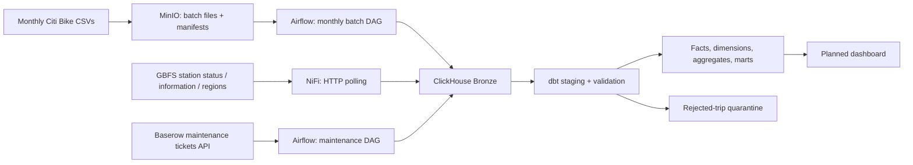
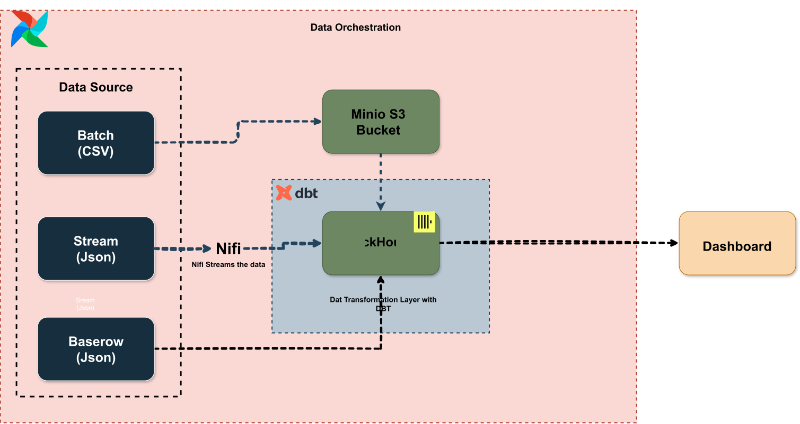
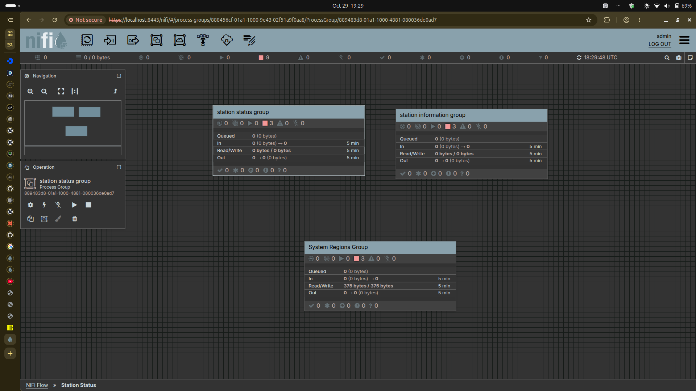
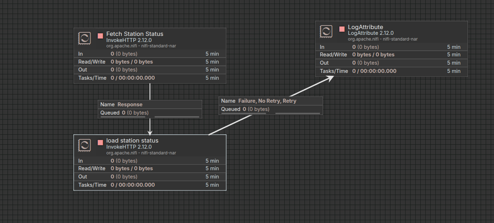
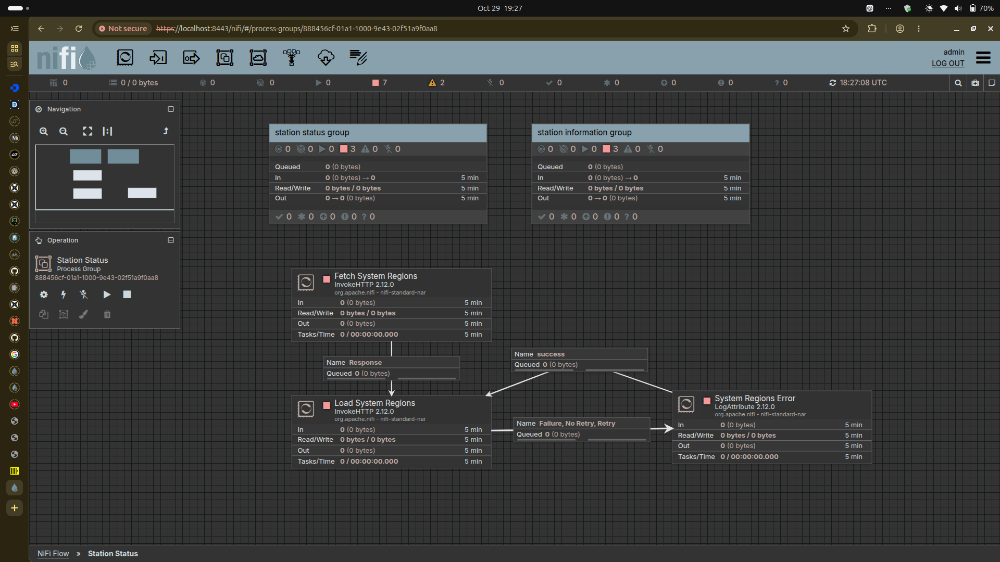
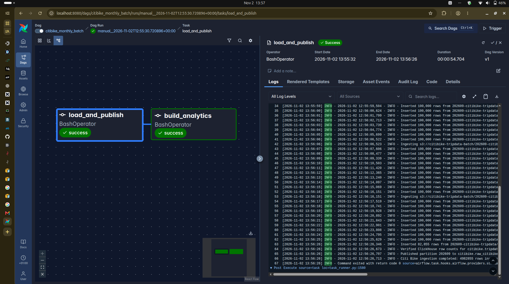

# Citi Bike Data Platform

A local, containerized **ELT data engineering project** combining historical Citi Bike trip files, near-real-time GBFS station feeds, and operational maintenance tickets from Baserow. The platform uses **MinIO, Apache Airflow, Apache NiFi, ClickHouse, Python, and dbt** to ingest, validate, model, and serve analytical data.

The pipeline supports month-selectable historical backfills, repeatable monthly publication, row-level trip validation and quarantine, current station availability, rebalancing signals, and maintenance workload metrics. A dashboard is a planned consumer of the curated models; it is not included in this repository.

> **Implementation status (November 2026):** April 2026 and September 2026 trip releases have been loaded and successfully reprocessed without duplicating Bronze rows. Multi-month demand baselines and the row-level trip validation/quarantine path have been built and checked. Efficient cross-row duplicate resolution, automated quarantine reconciliation tests, synthetic rejection tests, and full SCD Type 2 as-of trip joins remain follow-up work; see [Known limitations](#known-limitations-and-next-steps).

## Contents

- [Architecture](#architecture)
- [Data sources](#data-sources)
- [Repository structure](#repository-structure)
- [Getting started](#getting-started)
- [Monthly trip ingestion and backfills](#monthly-trip-ingestion-and-backfills)
- [Baserow maintenance-ticket integration](#baserow-maintenance-ticket-integration)
- [Transformation and quarantine](#transformation-and-quarantine)
- [Operational checks](#operational-checks)
- [Known limitations and next steps](#known-limitations-and-next-steps)

## Architecture



**ELT:** source records are landed in ClickHouse before SQL cleansing and business transformations. File integrity checks take place before batch publication. Bronze, Silver, and Gold are **logical layers in the `citibike` database**, not three separate ClickHouse databases.

| Layer | Implemented relations / purpose |
| --- | --- |
| Bronze | `raw_citibike_tripdata_v2`, three GBFS raw-response tables, `baserow_maintenance_tickets_raw`, and `baserow_completed_extractions`. |
| Silver | `stg_citibike__*` views that normalize and parse source fields; `int_trip_validation` classifies individual trips. |
| Quarantine | `tripdata_quarantine` stores trip rows currently classified as `REJECTED`, including validation codes and original source values. |
| Gold | Trips, station availability, station/region dimensions, demand aggregates, rebalancing, and maintenance-ticket analytics. |

### Project diagrams












> The linked diagrams are preserved from the original README; some may not yet show the newly added Baserow, multi-month backfill, or validation branches. The Mermaid diagram above describes the current intended flow more completely.

## Data sources

### 1. Monthly trip-history CSVs (batch)

Source: [Citi Bike system data](https://citibikenyc.com/system-data). This project uses the NYC release files, excluding Jersey City files with the `JC` prefix. Multiple CSV parts for a month form a single release and are appended at ingest.

| Loaded release | CSV parts | Verified rows |
| --- | ---: | ---: |
| April 2026 (`2026-04`) | 4 | 3,860,371 |
| September 2026 (`2026-09`) | 5 | 4,982,855 |
| **Combined** | **9** | **8,843,226** |

The 13 publisher fields are: `ride_id`, `rideable_type`, `started_at`, `ended_at`, `start_station_name`, `start_station_id`, `end_station_name`, `end_station_id`, `start_lat`, `start_lng`, `end_lat`, `end_lng`, and `member_casual`.

Bronze preserves these as strings and adds `source_locator`, `batch_id`, `release_month`, and `ingested_at`. The current target is **`citibike.raw_citibike_tripdata_v2`**, partitioned by `release_month`.

### 2. GBFS station snapshots (NiFi streaming)

| Feed | What it supplies |
| --- | --- |
| [`station_status.json`](https://gbfs.lyft.com/gbfs/2.3/bkn/en/station_status.json) | Bike/dock counts, rental/return status, and report timestamps. |
| [`station_information.json`](https://gbfs.lyft.com/gbfs/2.3/bkn/en/station_information.json) | Station names, short codes, coordinates, capacity, and region references. |
| [`system_regions.json`](https://gbfs.lyft.com/gbfs/2.3/bkn/en/system_regions.json) | Region identifiers and names. |

NiFi **polls station snapshots**; these are not ride-event streams. Full responses are retained as `raw_payload` in three Bronze tables: `stream_stations_status_raw`, `stream_station_information_raw`, and `stream_system_regions_raw`. The latest-availability model is designed to serve live dashboard queries without discarding the historical raw responses.

### 3. Baserow maintenance tickets (Airflow + REST API)

Baserow is the project's **operational ticket source**, separate from Citi Bike's public feeds. The Airflow DAG `citibike_baserow_maintenance` calls the Baserow row API, ingests the current ticket snapshot, and builds maintenance analytics. It does **not** run Baserow itself in Docker or capture a real-time event stream.

The source payload includes fields such as `ticket_id`, `station_code`, `issue_type`, `status`, `priority`, `reported_at`, `resolved_at`, and `repair_cost_usd`. Choice fields such as `issue_type`, `status`, and `priority` are nested JSON objects: the dbt staging model extracts their `.value` attributes.

See [Baserow maintenance-ticket integration](#baserow-maintenance-ticket-integration) for the complete flow and configuration.

## Repository structure

```text
citibike/
├── README.md
├── Makefile
├── .env.example
├── requirements.txt
├── manifest.yaml
├── schema_contract.yaml
├── containers/
│   ├── airflow/
│   │   ├── Dockerfile
│   │   ├── docker-compose.yaml
│   │   └── dags/
│   │       ├── citibike.py        # Monthly trip backfill
│   │       └── baserow.py         # Maintenance-ticket extraction
│   ├── clickhouse/docker-compose.yaml
│   ├── minio/docker-compose.yaml
│   └── nifi/docker-compose.yaml
├── src/
│   ├── createTable.py
│   ├── batch_manifest.py
│   ├── manifest_reader.py
│   ├── data_loader.py
│   ├── baserow_reader.py
│   ├── baserow_loader.py
│   └── readObject.py
├── utils/
│   ├── credentials.py
│   ├── dwh_connect.py
│   ├── s3_connect.py
│   └── logging_config.py
├── citibike_analytics/
│   ├── README.md
│   ├── dbt_project.yml
│   ├── models/
│   │   ├── staging/
│   │   ├── intermediate/
│   │   └── marts/
│   └── tests/
└── tests/
```

Some models described below (notably the new trip-validation and quarantine models) were created after the last shared ZIP snapshot. This README reflects the working changes reported in the project workflow, not a claim that those new files were present in that older archive.

## Getting started

### Runtime components

| Component | Configuration in the available repository snapshot |
| --- | --- |
| Airflow | `apache/airflow:3.3.2-python3.12`, CeleryExecutor |
| NiFi | `apache/nifi:2.12.0` |
| ClickHouse | `clickhouse/clickhouse-server:26.8` |
| MinIO | `quay.io/minio/aistor/minio:latest` |
| PostgreSQL / Redis | Airflow metadata / Celery broker |
| dbt CLI | `2.0.9` in `requirements.txt` |
| Python | 3.12 container runtime |

Install Docker Engine, Docker Compose v2, and GNU Make. Allow enough memory and disk for the Airflow stack, ClickHouse, a monthly work table, and dbt table builds.

### Environment variables

Copy `.env.example` to `.env` on a **fresh** checkout; don't overwrite an existing configured file. Configure the variables for each service and the container networking mode you are using. Typical required variables include:

```dotenv
CLICKHOUSE_DB=citibike
CLICKHOUSE_HOST=clickhouse
CLICKHOUSE_HTTP_PORT=8123
CLICKHOUSE_USER=REPLACE_WITH_USER
CLICKHOUSE_PASSWORD=REPLACE_WITH_PASSWORD

MINIO_BUCKET=citibike-tripdata-batch
MINIO_ENDPOINT_URL=http://minio:9000
# Also configure the MinIO access/secret credentials used by utils/s3_connect.py.

DBT_PROJECT_DIR=/opt/citibike/citibike_analytics
DBT_PROFILES_DIR=/opt/citibike/citibike_analytics

BASEROW_API_TOKEN=REPLACE_WITH_PRIVATE_TOKEN
BASEROW_TABLE_ID=REPLACE_WITH_NUMERIC_TABLE_ID
```

`clickhouse` and `minio` are container-network hostnames. If running a Python command directly on the host, use the correct host-accessible addresses instead. Do not commit `.env`, real API tokens, passwords, or downloaded private Baserow ticket data.

The dbt profile (`profiles.yml`) must point to ClickHouse. Airflow uses `/opt/citibike-venv/bin/python` and `/opt/citibike-venv/bin/dbt` installed in the custom worker image.

### Start services and initialize Bronze tables

From the repository root:

```bash
make up
make init-db
```

`make init-db` is the initialization command documented in the supplied root README. **Check that your current `Makefile` defines it:** the older project ZIP does not yet contain that target. The target should invoke `src.createTable` in an environment with valid ClickHouse credentials. `src/createTable.py` declares `raw_citibike_tripdata_v2`, the three GBFS raw tables, and both Baserow raw/extraction-control tables in the updated workflow.

Verify tables in ClickHouse:

```sql
SHOW CREATE TABLE citibike.raw_citibike_tripdata_v2;
SHOW CREATE TABLE citibike.baserow_maintenance_tickets_raw;
SHOW CREATE TABLE citibike.baserow_completed_extractions;
```

`CREATE TABLE IF NOT EXISTS` is safe to repeat but **does not migrate** an existing table definition. Avoid deleting Bronze tables when updating a schema.

## Monthly trip ingestion and backfills

### MinIO layout

The current object-store pattern keeps both CSVs and per-release manifests in the `citibike-tripdata-batch` bucket:

```text
citibike-tripdata-batch/
├── manifests/
│   ├── batch-manifest-2026-04.json
│   └── batch-manifest-2026-09.json
├── 202604-citibike-tripdata/
│   ├── 202604-citibike-tripdata_1.csv
│   └── ... (4 files total)
└── 202609-citibike-tripdata/
    ├── 202609-citibike-tripdata_1.csv
    └── ... (5 files total)
```

The initializer may create a separate `citibike-xcom` bucket, but the batch DAG does **not** pass CSVs or manifests via XCom; the files remain in MinIO.

### Backfill one release

1. Upload all CSV parts for the selected month into its `YYYYMM-citibike-tripdata/` prefix in MinIO.
2. Create and publish a month-specific manifest from those **MinIO objects** (the current implementation computes file checksums and counts rather than relying on a host-local CSV folder).
3. Validate the manifest and file objects before loading.
4. Trigger the `citibike_monthly_batch` Airflow DAG with its `release_month` parameter (for example, `2026-04`).
5. Airflow verifies the selected release, loads its month, and builds analytics via dbt.

Commands below execute **from the repository root** and use the Airflow worker's Python environment:

```bash
# April example: create/publish a manifest for four MinIO CSV parts
docker compose --env-file .env -f containers/airflow/docker-compose.yaml exec airflow-worker \
  /opt/citibike-venv/bin/python -m src.batch_manifest \
  --release-month 2026-04 --expected-files 4 --publish

# April example: check the stored manifest and source objects, without loading
docker compose --env-file .env -f containers/airflow/docker-compose.yaml exec airflow-worker \
  /opt/citibike-venv/bin/python -m src.data_loader \
  --manifest-key manifests/batch-manifest-2026-04.json \
  --data-prefix 202604-citibike-tripdata/ --validate-only
```

For September, change to `2026-09`, `--expected-files 5`, `manifests/batch-manifest-2026-09.json`, and `202609-citibike-tripdata/`.

The updated Airflow DAG accepts a run-specific `release_month` (format `YYYY-MM`), derives the matching manifest key/data prefix, and runs manifest validation, publication, and dbt builds. Trigger it manually from the Airflow UI; it has no automatic schedule in the available implementation.

### Publication and rerun behavior

The loader creates a temporary ClickHouse work table using the target schema, loads the month's CSVs, checks counts and batch metadata, and publishes a complete month with `REPLACE PARTITION`. A rerun **replaces that month** rather than appending another copy. Other release-month partitions remain intact.

Verified example:

```sql
SELECT release_month,
       count() AS total_rows,
       uniqExact(batch_id) AS distinct_batches
FROM citibike.raw_citibike_tripdata_v2
GROUP BY release_month
ORDER BY release_month;
```

Expected for the two loaded releases: **3,860,371 April rows**, **4,982,855 September rows**, and **one batch per release month**. Re-running April was observed to leave those counts unchanged.

**Historical analytics:** `int_station_hourly_demand_baseline` now rebuilds weekday/hour demand baselines for **all available release months** instead of only the month most recently loaded. The operational rebalancing mart selects the **latest available baseline month** to avoid duplicate station rows.

## Baserow maintenance-ticket integration

### What the integration does

`containers/airflow/dags/baserow.py` defines the **`citibike_baserow_maintenance`** DAG. The workflow is manual (`schedule=None`), uses two tasks, and is independent of the monthly trip DAG:

```text
Baserow API
  └── src.baserow_reader.fetch_baserow_tickets
        └── src.baserow_loader
              ├── citibike.baserow_maintenance_tickets_raw
              └── citibike.baserow_completed_extractions
                    └── dbt: stg_citibike__baserow_maintenance_tickets
                          └── fct_maintenance_tickets
                                └── agg_station_maintenance
```

The actual Airflow task chain is `load_baserow` → `build_baserow_analytics`. The latter runs `dbt build --select +agg_station_maintenance` and provides `baserow_maintenance_table_id` from `BASEROW_TABLE_ID`.

**Reader (`src/baserow_reader.py`):** authenticates with a private API token; requests named fields (`user_field_names=true`); paginates up to 200 rows per page; verifies the API-reported total and unique Baserow row IDs; and returns a single extraction with a UUID and UTC extraction time.

**Loader (`src/baserow_loader.py`):** serializes complete original row objects into `raw_payload`, inserts the extraction, checks count and distinct row IDs, then writes a **completion marker**. Staging reads **only the latest completed extraction** for the configured table ID. This prevents an incomplete extraction from silently becoming the current modeled snapshot.

**dbt models:**

| Model | Grain / output |
| --- | --- |
| `stg_citibike__baserow_maintenance_tickets` | One ticket per Baserow row in the latest completed extraction; parses categories, timestamps, and decimal repair cost. |
| `fct_maintenance_tickets` | One current ticket enriched with the latest station metadata; includes mapping status, backlog/resolution flags, and `resolution_hours`. |
| `agg_station_maintenance` | Maintenance workload by station code: open/in-progress/resolved counts, high-priority backlog, average resolution time, and recorded costs. |

Baserow ticket attributes are operational input, not GBFS station status. The latest-extraction staging policy produces a **current snapshot**, not a ticket-history SCD or event-by-event change log. Raw extractions remain available for investigation.

### Run and verify

Set `BASEROW_API_TOKEN` and `BASEROW_TABLE_ID` securely in the Airflow runtime, ensure the Bronze tables exist, then trigger **`citibike_baserow_maintenance`** in the Airflow UI. For a manual rerun from the worker:

```bash
docker compose --env-file .env -f containers/airflow/docker-compose.yaml exec airflow-worker \
  /opt/citibike-venv/bin/python -m src.baserow_loader
```

Check completion markers and the modeled results:

```sql
SELECT baserow_table_id, extracted_at, expected_rows, completed_at
FROM citibike.baserow_completed_extractions
ORDER BY completed_at DESC LIMIT 5;

SELECT count() FROM citibike.stg_citibike__baserow_maintenance_tickets;
SELECT count() FROM citibike.fct_maintenance_tickets;
SELECT count() FROM citibike.agg_station_maintenance;
```

The standalone loader only ingests data; run the Airflow DAG or the relevant dbt build to refresh maintenance analytics afterward. A reported repair cost of `NULL` means **unknown**, not zero.

## Transformation and quarantine

### Row-level trip validation

`stg_citibike__raw_citibike_tripdata` casts and normalizes the Bronze strings, while preserving original timestamp and coordinate strings (`raw_started_at`, `raw_ended_at`, `raw_start_lat`, `raw_start_lng`, `raw_end_lat`, `raw_end_lng`) for error investigation.

`int_trip_validation` evaluates **each trip row**, attaching `error_codes`, `warning_codes`, and a `validation_status`:

- **`VALID`**: passes the implemented rejection rules and is eligible for `fct_trips`.
- **`REJECTED`**: fails one or more rules; retained in `int_trip_validation` and selected into `tripdata_quarantine`.
- Warnings such as missing station identifiers or unusual durations can coexist with `VALID`; they do not automatically remove a trip.

Implemented rejection checks cover blank ride IDs; unparseable/malformed or out-of-order trip timestamps; unexpected bike/membership categories; and invalid nonblank coordinates. `fct_trips` reads validated trips with `WHERE validation_status = 'VALID'` rather than silently filtering invalid trip times.

The current `tripdata_quarantine` model is a **dbt table** rebuilt from rows marked `REJECTED`. Its key diagnostic columns include `ride_id`, `release_month`, `source_locator`, `batch_id`, original raw values, and `error_codes`. Because the two loaded months passed the implemented row-level checks, it may be empty; this is not proof that synthetic rejected records or duplicate handling have been tested.

**Not yet implemented:** scalable exact-replay/conflicting-ride-ID classification. The original approach exceeded the ClickHouse container's ~3.5 GiB memory limit, so it was removed from the row-level validation model pending an efficient duplicate-audit design. The `schema_contract.yaml` is a design contract; the new SQL enforces only the rules described above, not the entire YAML contract.

### Validate counts and inspect rejections

```sql
SELECT release_month, validation_status, count() AS records
FROM citibike.int_trip_validation
GROUP BY release_month, validation_status
ORDER BY release_month, validation_status;

SELECT ride_id, release_month, source_locator, error_codes
FROM citibike.tripdata_quarantine
LIMIT 20;

SELECT
  (SELECT count() FROM citibike.stg_citibike__raw_citibike_tripdata) AS staging_rows,
  (SELECT count() FROM citibike.int_trip_validation) AS validation_rows,
  (SELECT countIf(validation_status = 'VALID') FROM citibike.int_trip_validation) AS valid_rows,
  (SELECT countIf(validation_status = 'REJECTED') FROM citibike.int_trip_validation) AS rejected_rows,
  (SELECT count() FROM citibike.tripdata_quarantine) AS quarantined_rows;
```

For the **current row-level-only classification**, `staging_rows = validation_rows = valid_rows + rejected_rows` and `rejected_rows = quarantined_rows`. These are documented manual checks; permanent reconciliation tests and synthetic invalid-record tests are follow-up work.

See [Analytics README](./citibike_analytics/README.md) for model lineage, test commands, and analytical queries.

## Operational checks

- **Airflow monthly DAG:** `citibike_monthly_batch` (manual, release-month parameter); its workload uses the `citibike_warehouse` pool and a single active DAG run.
- **Airflow Baserow DAG:** `citibike_baserow_maintenance` (manual, separate load-and-build workflow).
- **NiFi polling:** runs independently of the batch DAGs. Query-time station freshness should be assessed independently of historical trip availability.
- **ClickHouse:** inspect batch partitions, quarantine records, Baserow completion markers, and current station availability after a run.
- **dbt:** run `dbt build` or a targeted `dbt build --select model+` with the correct project/profile. The containerized worker provides the pinned CLI.

## Known limitations and next steps

1. **Full trip-contract enforcement:** row-level rejection/quarantine exists, but scalable duplicate resolution, automated reconciliation tests, and synthetic error-injection tests still need completion.
2. **Historical station and region attributes:** the current latest-only dimensions are appropriate for current-state dashboards but do not establish attributes as of April/September trip times. A separate observed-history/SCD Type 2 dimension and time-aware joins are planned. Historic information cannot be recovered for dates before metadata collection began.
3. **Rebalancing priority:** a heuristic for operational triage, not a forecast or dispatch optimization. It depends on current station-status freshness and an explicitly chosen (currently latest available) historical demand baseline.
4. **Baserow extraction semantics:** the API is polled for complete ticket snapshots; it is not CDC. The completion marker gates incomplete runs, but extraction publication spans separate ClickHouse inserts and is not a database-wide transaction.
5. **Dashboard:** not yet implemented. Intended consumers include latest station availability, rebalancing recommendations, trip-demand trends, and maintenance ticket aggregates.
6. **Security and reproducibility:** keep `.env`/tokens outside source control; ensure the current `Makefile` and Airflow DAG reflect the newer schema/backfill code before publishing this README. The older shared ZIP predates several validated changes.

## Metadata and source contracts

| Artifact | Role |
| --- | --- |
| `manifest.yaml` | Intended source catalog, schedules, and relationships; not an executable DAG/loader configuration. |
| `schema_contract.yaml` | Planned source schema and data quality policies. Only some trip rules are enforced in the current dbt models. |
| `manifests/batch-manifest-YYYY-MM.json` in MinIO | Execution-time release description: object names, counts, sizes, SHA-256 checksums, and deterministic `batch_id`. |

The batch fingerprint supports reproducibility and change detection; it is **not a cryptographic signature of publisher identity**.
