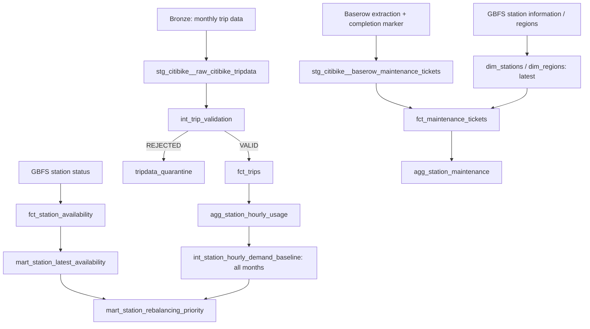

# Citi Bike Analytics (dbt + ClickHouse)

dbt models for the **Silver and Gold layers** of the Citi Bike ELT platform, combining monthly ride history, GBFS station snapshots, and maintenance tickets extracted from Baserow.

The project supports **multi-month historical demand baselines**, **row-level trip validation and quarantine**, station availability, rebalancing metrics, and **maintenance-ticket analytics**. Models run against the `citibike` ClickHouse database. See the [root README](../README.md) for infrastructure, data ingestion, environment variables, and backfill commands.

> **Status (November 2026):** April and September 2026 trip releases are loaded. The multi-month baseline and row-level quarantine flow have been exercised, with no rejected trip rows in those two releases under the implemented checks. Duplicate resolution and automated negative-test/reconciliation coverage are still pending. The history-aware SCD Type 2 join is not yet completed.

## Contents

- [Model layers and lineage](#model-layers-and-lineage)
- [Running dbt](#running-dbt)
- [Monthly backfills and demand baselines](#monthly-backfills-and-demand-baselines)
- [Trip validation and quarantine](#trip-validation-and-quarantine)
- [Baserow maintenance models](#baserow-maintenance-models)
- [Current station availability and rebalancing](#current-station-availability-and-rebalancing)
- [Quality checks](#quality-checks)
- [Assumptions and outstanding work](#assumptions-and-outstanding-work)

## Model layers and lineage

All database relations live in **`citibike`**; layer names are logical labels.

| Layer | Models / responsibilities |
| --- | --- |
| Bronze sources | `raw_citibike_tripdata_v2`; raw GBFS status, station information, regions; `baserow_maintenance_tickets_raw`; `baserow_completed_extractions`. |
| Silver: staging | `stg_citibike__raw_citibike_tripdata`, `stg_citibike__stream_station_status`, `stg_citibike__stream_station_information`, `stg_citibike__stream_system_regions`, `stg_citibike__baserow_maintenance_tickets`. |
| Intermediate | `int_trip_validation` (table), `int_station_hourly_demand_baseline` (table). |
| Rejected trip store | `tripdata_quarantine` (table; row-level rejections). |
| Gold: dimensions and facts | `dim_stations`, `dim_regions`, `fct_trips`, `fct_station_availability`, `fct_maintenance_tickets`. |
| Gold: aggregates and marts | `agg_station_hourly_usage`, `agg_station_hourly_availability`, `agg_station_maintenance`, `mart_station_latest_availability`, `mart_station_rebalancing_priority`. |



### Physical source declarations

Source name: `citibike_raw`; declarations are in `models/staging/_src_citibike.yml`.

| Logical source in dbt | ClickHouse table |
| --- | --- |
| `raw_citibike_tripdata` | `citibike.raw_citibike_tripdata_v2` (`identifier` override) |
| `stream_stations_status_raw` | `citibike.stream_stations_status_raw` |
| `stream_station_information_raw` | `citibike.stream_station_information_raw` |
| `stream_system_regions_raw` | `citibike.stream_system_regions_raw` |
| `baserow_maintenance_tickets_raw` | `citibike.baserow_maintenance_tickets_raw` |
| `baserow_completed_extractions` | `citibike.baserow_completed_extractions` |

The source declarations describe physical relations; they do not enforce the complete `schema_contract.yaml` themselves.

### Station identifier mapping

The trip files' `start_station_id` / `end_station_id` are **station codes**. They are joined to GBFS `station_information.short_name`, exposed as `dim_stations.station_code`, to obtain a GBFS `station_id`.

```text
Trip CSV station code -> GBFS short_name -> dim_stations.station_id
                                     -> station_status.station_id
```

Keep codes as strings; values such as `6879.04` must not be interpreted as floating-point measurements. Unmatched station codes remain visible as unresolved mappings. Current `dim_stations` uses the latest observed metadata, not historically correct as-of station attributes.

## Running dbt

Prerequisites: ClickHouse and its Bronze tables must exist; the relevant data must have been ingested; the ClickHouse `profiles.yml` and required runtime environment variables must be configured. The repository pins **dbt 2.0.9** in `requirements.txt`.

### Airflow-managed builds

The monthly DAG `citibike_monthly_batch` invokes dbt from the custom Airflow worker environment after the selected monthly partition is published. The separate `citibike_baserow_maintenance` DAG runs:

```bash
/opt/citibike-venv/bin/dbt build \
  --project-dir "$DBT_PROJECT_DIR" \
  --profiles-dir "$DBT_PROFILES_DIR" \
  --select '+agg_station_maintenance' \
  --vars "baserow_maintenance_table_id: ${BASEROW_TABLE_ID:?BASEROW_TABLE_ID is required}"
```

This selector builds the maintenance aggregate, its upstream dependencies, and related tests. A successful Baserow extraction must be published first.

### Targeted local builds

From `citibike_analytics/`, in an environment with dbt installed and a valid ClickHouse profile:

```bash
# Syntax/compilation check
dbt compile --select int_trip_validation

# Build validation and quarantine
dbt build --select +tripdata_quarantine

# Build fact trips and dependent analytics
dbt build --select fct_trips+

# Rebuild the all-month demand baseline and operational mart
dbt build --select int_station_hourly_demand_baseline mart_station_rebalancing_priority

# Build the maintenance branch
dbt build --select +agg_station_maintenance \
  --vars "baserow_maintenance_table_id: ${BASEROW_TABLE_ID}"
```

`int_trip_validation` uses **table materialization**, which avoids repeating row-level checks for every downstream query. The earlier high-cardinality duplicate-fingerprint aggregation and self-join exceeded the available ClickHouse memory (~3.5 GiB); it was deliberately removed and has **not yet** been replaced by an efficient audit model.

## Monthly backfills and demand baselines

Monthly selection is an **ingestion/Airflow concern**, not a restriction on the final demand-baseline table:

1. Airflow receives `release_month` (e.g. `2026-04`) and selects the corresponding MinIO manifest and prefix.
2. The loader validates source objects and publishes that month using ClickHouse `REPLACE PARTITION`, leaving previously loaded months available.
3. `fct_trips` and `agg_station_hourly_usage` reflect the trips in the warehouse.
4. `int_station_hourly_demand_baseline` now discovers **all available months** and builds one complete 7-day × 24-hour grid **per station per month**.
5. `mart_station_rebalancing_priority` uses the **latest available reporting month** as its reference baseline, preventing extra station rows when historical months coexist.

Observed sample:

| Reporting window | Baseline rows | Stations |
| --- | ---: | ---: |
| `2026-04-01` to `2026-05-01` (end exclusive) | 423,528 | 2,521 |
| `2026-09-01` to `2026-10-01` (end exclusive) | 423,528 | 2,521 |

Each month: `2,521 × 7 × 24 = 423,528` station/weekday/hour combinations. Equal grid sizes do **not** mean the months experienced equal trip demand. Calendar opportunities are computed using the `America/New_York` timezone; the hourly enumeration respects daylight-saving changes and includes zero-trip hours in the denominator.

```sql
SELECT reporting_start_date, reporting_end_date_exclusive,
       count() AS baseline_rows, uniqExact(station_id) AS stations
FROM citibike.int_station_hourly_demand_baseline
GROUP BY reporting_start_date, reporting_end_date_exclusive
ORDER BY reporting_start_date;
```

The model is currently **full-table materialized**: each dbt build recreates baselines for all available months. This is straightforward and idempotent, but could become expensive with years of history.

## Trip validation and quarantine

### Validation is row-level

`stg_citibike__raw_citibike_tripdata` parses timestamps/coordinates, normalizes blank identifiers, and exposes the original timestamp and coordinate strings for audit. `int_trip_validation` then generates:

| Column | Meaning |
| --- | --- |
| `error_codes` | Array of rejection reasons for this trip. |
| `warning_codes` | Array of non-rejecting quality warnings. |
| `validation_status` | `VALID` or `REJECTED` in the current implementation. |
| `source_locator`, `batch_id`, `release_month` | Source lineage for investigation and reconciliation. |

**Current rejection rules:** missing ride ID; invalid/unparseable start or end timestamps; `ended_at <= started_at`; unsupported bike/membership values; or invalid **nonblank** coordinate values/ranges. Missing station identifiers and unusual trip durations are recorded as warnings, not rejection reasons.

`fct_trips` selects `WHERE validation_status = 'VALID'`; `tripdata_quarantine` selects `WHERE validation_status = 'REJECTED'` from the same validation table. Rejected records remain available for diagnosis instead of being silently lost. Both April and September passed the implemented row-level rejection checks in the reported run, so an **empty quarantine table is expected** for those batches.

```sql
-- Month-level classification counts (each underlying check is row-level)
SELECT release_month, validation_status, count() AS rows
FROM citibike.int_trip_validation
GROUP BY release_month, validation_status
ORDER BY release_month, validation_status;

-- Inspect any rejected rows
SELECT ride_id, release_month, source_locator,
       raw_started_at, raw_ended_at, error_codes, warning_codes
FROM citibike.tripdata_quarantine
LIMIT 50;
```

### Reconciliation

Until duplicate detection is implemented, classify the current input set with:

```text
staging rows = validation rows = VALID rows + REJECTED rows
REJECTED rows = quarantine rows
```

```sql
SELECT
  (SELECT count() FROM citibike.stg_citibike__raw_citibike_tripdata) AS staging_rows,
  (SELECT count() FROM citibike.int_trip_validation) AS validation_rows,
  (SELECT countIf(validation_status = 'VALID') FROM citibike.int_trip_validation) AS valid_rows,
  (SELECT countIf(validation_status = 'REJECTED') FROM citibike.int_trip_validation) AS rejected_rows,
  (SELECT count() FROM citibike.tripdata_quarantine) AS quarantined_rows;
```

The two currently loaded releases contain **8,843,226 source rows** combined. A future implementation of exact replay deduplication should introduce a separate deduplication count/status and extend this equality accordingly.

**Limitations:** the original fingerprint + `uniqExact` + self-join + `row_number()` design exceeded ClickHouse memory and was removed. Duplicate IDs were checked manually for the two known months (zero found), but deduplication and conflicting-duplicate quarantine are **not automatically enforced**. The synthetic negative test and permanent dbt reconciliation test are also pending. The project-level `schema_contract.yaml` describes broader intended rules than the SQL currently implements.

## Baserow maintenance models

Baserow is read through the API by `src.baserow_reader` and `src.baserow_loader`; the manual Airflow DAG `citibike_baserow_maintenance` runs extraction then `dbt build --select +agg_station_maintenance`. It is **snapshot extraction**, not CDC.

### Latest completed extraction rule

`baserow_maintenance_tickets_raw` stores `baserow_table_id`, `baserow_row_id`, `extraction_id`, `extracted_at`, `loaded_at`, and the original JSON `raw_payload`. `baserow_completed_extractions` stores an extraction marker **only after** row-count and unique-row-ID verification.

The staging view selects the latest completed extraction for the configured `baserow_maintenance_table_id` rather than combining tickets across all historical runs. Thus each ticket appears once in the **current modeled snapshot**. An incomplete raw extraction is not promoted into analytics.

### Baserow model inventory

| Model | Key fields and transformations |
| --- | --- |
| `stg_citibike__baserow_maintenance_tickets` | Parses `ticket_id`, `station_code`, nested `issue_type.value`, `status.value`, and `priority.value`; reads `reported_at`/`resolved_at` as UTC timestamps and `repair_cost_usd` as a two-decimal numeric. |
| `fct_maintenance_tickets` | Left joins the ticket's `station_code` to current `dim_stations`, adds `station_mapping_status`, `is_backlog`, `is_resolved`, and `resolution_hours`. |
| `agg_station_maintenance` | Groups by station mapping and computes total/open/in-progress/resolved tickets, high-priority backlog, average resolution time, recorded repair cost, and missing-cost counts. |

Unmatched station codes stay visible through `station_mapping_status`; the schema test treats unmatched mappings as a warning. `repair_cost_usd = NULL` is unknown, not $0.

```sql
SELECT baserow_table_id, extracted_at, expected_rows, completed_at
FROM citibike.baserow_completed_extractions
ORDER BY completed_at DESC
LIMIT 5;

SELECT station_code, open_tickets, in_progress_tickets,
       resolved_tickets, high_priority_backlog_tickets,
       avg_resolution_hours, recorded_repair_cost_usd
FROM citibike.agg_station_maintenance
ORDER BY high_priority_backlog_tickets DESC
LIMIT 20;
```

Because the model uses a configurable Baserow table, the dbt variable must identify the same table as `BASEROW_TABLE_ID`. Keep the API token out of code and documentation. The latest-completed extraction model does **not** reconstruct each ticket's full change history.

## Current station availability and rebalancing

`fct_station_availability` consumes GBFS snapshots; `agg_station_hourly_availability` aggregates history; `mart_station_latest_availability` selects the freshest known station-status row for each station at query time. Current-availability eligibility reflects station status, metadata presence, and feed freshness.

`mart_station_rebalancing_priority` combines current availability, the latest historical demand baseline, and recent zero-stock observation shares. Its weighted score is an **advisory heuristic**, not a forecast or dispatch decision. It uses a current-state station grain and is designed not to multiply stations due to multiple baseline months.

Live status can update independently of batch trip backfills. However, the current `dim_stations` is a dbt table based on latest-known station information; its metadata is refreshed when dbt rebuilds it, not automatically at every NiFi poll.

## Quality checks

### dbt model/test workflow

```bash
# Run the already-declared singular tests and model tests
dbt test

# Focused validation/quarantine branch
dbt build --select +tripdata_quarantine

# Check the maintenance branch (BASEROW_TABLE_ID must be set)
dbt build --select +agg_station_maintenance \
  --vars "baserow_maintenance_table_id: ${BASEROW_TABLE_ID}"
```

Existing project tests cover trip ID uniqueness in the fact, station-hour grain, availability metric bounds, baseline denominators/grain, rebalancing grain/integrity, and maintenance ticket integrity, with YAML tests for the Baserow models. The newer validation/quarantine branch still needs its own permanent reconciliation and synthetic rejection tests.

### Additional ClickHouse diagnostics

```sql
-- There should be no duplicate station/weekday/hour records per month
SELECT reporting_start_date, station_id, local_weekday, local_hour,
       count() AS occurrences
FROM citibike.int_station_hourly_demand_baseline
GROUP BY reporting_start_date, station_id, local_weekday, local_hour
HAVING occurrences > 1;

-- The rebalancing mart must stay at one row per station
SELECT station_id, count() AS occurrences
FROM citibike.mart_station_rebalancing_priority
GROUP BY station_id
HAVING occurrences > 1;
```

Both queries should return **zero rows** if the grain contracts hold.

## Assumptions and outstanding work

- **Bitemporal fidelity is not claimed.** Station and region dimensions currently use latest-known records. SCD Type 2 station/region history and trip-time as-of joins are still planned, and historical attributes cannot be inferred before the first observed station snapshot.
- **No CDC from Baserow.** The extraction keeps prior raw snapshots but the curated maintenance models use only the most recent *completed* snapshot.
- **Not all YAML contract rules are enforced.** Trip row-level quarantine is implemented; memory-efficient duplicate handling, source-row positioning, full cross-row controls, permanent reconciliation tests, and synthetic failure tests remain to be built.
- **Demand baselines are rebuilt across all months.** This matches the current small historical corpus. A later incremental strategy would require explicit monthly replacement and downstream month selection.
- **Live/current metrics are time-sensitive.** Freshness is evaluated separately from historical aggregation. No claim of a fully deployed dashboard is made.

For installation, Airflow commands, and exact April/September MinIO backfill examples, return to the [root README](../README.md).
